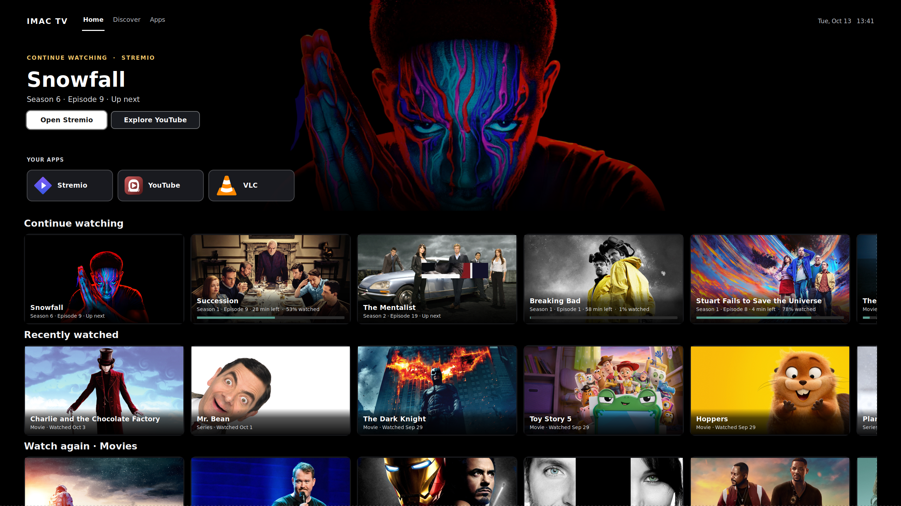

# iMac TV / Zorin TV 📺📱

> Transform your iMac or PC running **Zorin OS** (or Ubuntu/Debian) into a smart TV experience, complete with an artwork-rich TV Home interface, a responsive mobile web remote, and built-in **VacuumTube (YouTube Leanback)** and **Stremio**.



---

## Features

- 🛋️ **TV Home Interface (`home.py`)**:
  - Fullscreen 10-foot user interface built with GTK3 and CSS styling.
  - Quick-launch app shelf for **Stremio**, **YouTube (VacuumTube)**, and **VLC**.
  - Recommendation rails (**Continue Watching**, **Recently Watched**, **Watch Again**) automatically synced from Stremio.
  - Hero banner with backdrop artwork and details when highlighting any title.
  - On-screen clock, Wi-Fi status, IP address, and dynamic pairing code / QR code.

- 📱 **Mobile Web Remote Control (`web/` & `server.py`)**:
  - Zero app install needed on your phone — runs directly in any mobile web browser.
  - **D-Pad & Navigation**: Smooth remote navigation (Up, Down, Left, Right, OK, Back, Home).
  - **Touchpad & Mouse Mode**: Fluid pointer trackpad with click, right-click, and two-finger scroll.
  - **Media Controls**: Play/Pause, Rewind (-10s, -60s), Fast-Forward (+10s, +60s), Subtitle selection, and Subtitle sync delay.
  - **Keyboard Input**: Type text or search terms from your phone keyboard onto the TV screen.
  - **System Controls**: Hardware volume, mute, display brightness, screen blanking, sleep timer, and clean power-off.
  - **Security & Pairing**: Pair once using the on-screen 6-digit code or QR code; secure device cookie migration.

- 🍿 **Built-in Apps**:
  - **VacuumTube**: The official YouTube Leanback (Smart TV console) UI wrapped in Electron, featuring built-in ad-blocking and native gamepad/remote arrow navigation.
  - **Stremio**: Media streaming platform with automated library cache sync into TV Home.
  - **VLC**: Local and network media player with D-Bus MPRIS / MPV IPC integration.

---

## Installation on Zorin OS

### 1. Clone the Repository

```bash
git clone https://github.com/Obada-Fa/imac-tv.git ~/tvremote
cd ~/tvremote
```

### 2. Run the Installer

Run the automated installer script:

```bash
./install.sh
```

This single command will:
1. Install all necessary system APT packages (`python3-gi`, `gir1.2-gtk-3.0`, `wmctrl`, `xdotool`, `libxtst6`, etc.).
2. Set up **VacuumTube** and **Stremio** via Flathub / Flatpak (standard on Zorin OS).
3. Configure `tvremote.service` as a systemd user service (auto-starts on boot).
4. Configure desktop autostart so **TV Home** launches automatically on login.
5. Set up passwordless permissions for power off and desktop restart.

---

## App Installation Options

The installer defaults to Flatpak, which is the official and most reliable distribution method on Zorin OS. Additional options are available:

### Option A: Flatpak (Default & Recommended)
```bash
./install.sh --flatpak-apps
```
Installs `rocks.shy.VacuumTube` and `com.stremio.Stremio` from Flathub.

### Option B: Native `.deb` Packages
```bash
./install.sh --deb-apps
```
Or directly run:
```bash
bash scripts/install-deb-apps.sh
```
Downloads the official `.deb` releases from GitHub and dl.strem.io and installs them with `apt`.

### Option C: Build VacuumTube from Source
```bash
./install.sh --build-vacuumtube
```
Or directly run:
```bash
bash scripts/build-vacuumtube.sh
```
Clones `https://github.com/shy1132/VacuumTube.git`, installs Node.js/npm dependencies, and builds the Linux `.deb` and `.AppImage` packages using `electron-builder`.

---

## How to Pair Your Phone Remote

1. Ensure your phone is connected to the **same Wi-Fi network** as the TV.
2. Look at the TV Home screen: you will see your machine's IP address (e.g., `http://192.168.1.100:8765`) and a 6-digit pairing code.
3. On your phone, open the URL or click **"Pair phone / QR"** on the TV to scan the QR code.
4. Enter the 6-digit pairing code on your phone when prompted.
5. Your phone is now paired! The remote interface will load instantly.

```
┌──────────────────────────────────────────────┐
│  TV HOME SCREEN                              │
│  LAN: http://192.168.1.100:8765   PIN: 580708│
└──────────────────────────────────────────────┘
                       ▲
                       │ Pair via Browser / QR
                       ▼
┌──────────────────────────────────────────────┐
│  PHONE REMOTE INTERFACE                      │
│  [ Home ] [ Stremio ] [ YouTube ] [ VLC ]    │
│  [ ▲ ] [ ◀ ] [ OK ] [ ▶ ] [ ▼ ]              │
│  [ Touchpad ] [ Vol + / - ] [ Power Off ]    │
└──────────────────────────────────────────────┘
```

---

## Project Structure

```
├── install.sh                  # Complete automated installer
├── uninstall.sh                # Clean uninstallation script
├── scripts/
│   ├── install-apps.sh         # Installs VacuumTube & Stremio via Flatpak
│   ├── install-deb-apps.sh     # Downloads & installs native .deb packages
│   └── build-vacuumtube.sh     # Builds VacuumTube from source (electron-builder)
├── tvapp/
│   ├── server.py               # TV Controller HTTP server & X11 input injector
│   ├── home.py                 # Fullscreen GTK3 TV Home interface
│   ├── feed_sync.py            # Stremio cache & recommendations syncer
│   ├── web/                    # Mobile web remote UI (HTML, CSS, JS)
│   ├── assets/                 # App icons and preview artwork
│   ├── deploy/                 # Systemd service, sudoers, and smoke test scripts
│   ├── previews/               # UI preview screenshots
│   └── tests/                  # Automated unit test suite
├── imac_eq.py                  # PulseAudio / LADSPA DSP equalizer (for iMac built-in speakers)
└── remote.py                   # Standalone legacy X11 remote server
```

---

## Testing & Verification

Run the automated test suite:

```bash
cd tvapp
python3 -m unittest discover -s tests -v
```

All controller, network parsing, and pairing security tests should pass.

---

## Uninstallation

To remove the TV controller service, autostart entries, and sudoers rules:

```bash
./uninstall.sh
```
*(Your installed apps like VacuumTube and Stremio will be retained).*
