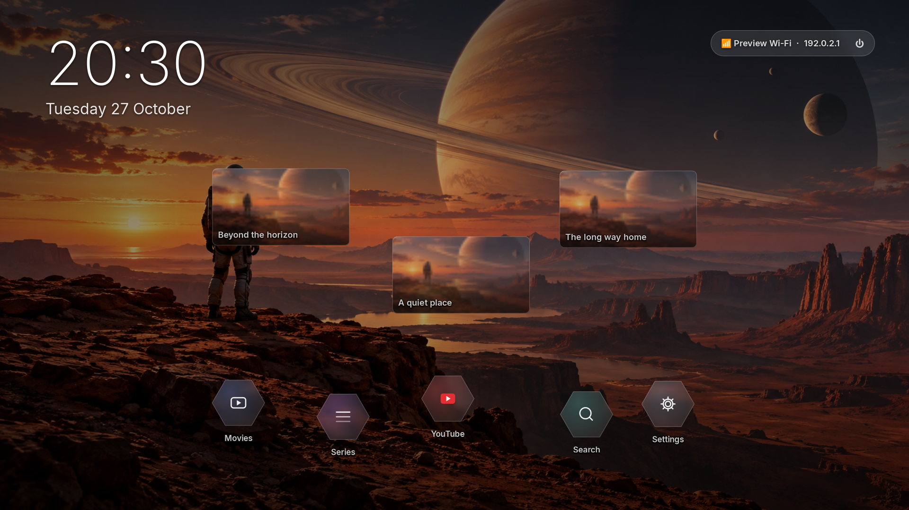
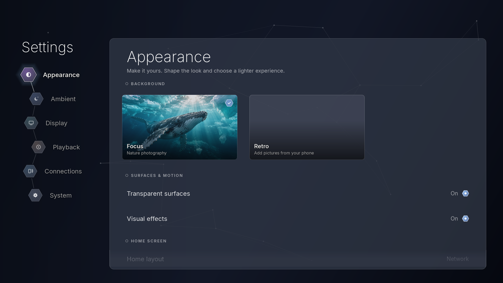
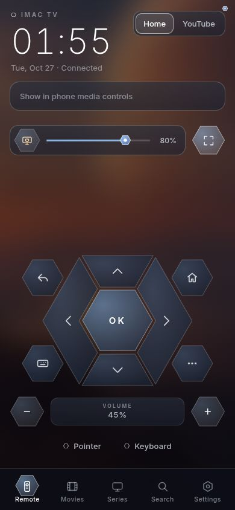
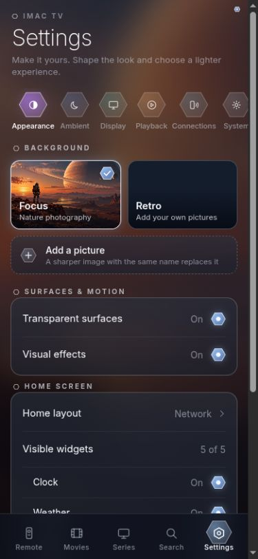

# Current app screenshots

TV captures made 27 October 2026 (Europe/Amsterdam) from source revision
`5919e14f702a67020f71c793753b0baff27db383`. Phone captures were refreshed the same
day from the local working tree after the requested removal of decorative lines
and dots; the clock is retained. This phone cleanup is recorded
by source hashes in `phone-manifest.json`, not claimed to exist in that base commit.
The user confirmed that this TV Settings layout matches their installed iMac.
These are **real app widgets with sample
data**, not live-device screenshots or proposed mockups. GTK content screens omit
the shell navigation header. The phone captures use the actual HTML, CSS and JS
served by an isolated preview server; no real TV is controlled.

Appearance: default Network layout, hexagon nodes, rounded tiles, transparency
and visual effects on. Fictional titles, existing placeholder artwork, fake
connection state and `192.0.2.1` are used. The phone's clock reflects capture time.
The TV Settings render has no Home photo behind it; an installed device can show
its own background. This does not change the shared menu layout or controls.

## TV




All TV views are captured at 1280 × 720 and 1920 × 1080:

| Menu | 1080p | 720p |
| --- | --- | --- |
| Home | [Open](home-1080.png) | [Open](home-720.png) |
| Appearance | [Open](settings-1080.png) | [Open](settings-720.png) |
| Ambient | [Open](settings-ambient-1080.png) | [Open](settings-ambient-720.png) |
| Display | [Open](settings-display-1080.png) | [Open](settings-display-720.png) |
| Playback | [Open](settings-playback-1080.png) | [Open](settings-playback-720.png) |
| Connections | [Open](settings-connections-1080.png) | [Open](settings-connections-720.png) |
| System | [Open](settings-system-1080.png) | [Open](settings-system-720.png) |
| Setting choice | [Open](setting-choice-1080.png) | [Open](setting-choice-720.png) |
| Power confirmation | [Open](power-1080.png) | [Open](power-720.png) |
| Movies | [Open](movies-1080.png) | [Open](movies-720.png) |
| Details | [Open](details-1080.png) | [Open](details-720.png) |
| Search | [Open](search-1080.png) | [Open](search-720.png) |
| Sources | [Open](sources-1080.png) | [Open](sources-720.png) |
| Stream startup | [Open](loading-1080.png) | [Open](loading-720.png) |

## Phone

<p>
  
  
</p>

| View | Capture dimensions |
| --- | --- |
| [Remote](phone-remote-390.jpg) | 390 × 844 |
| [Appearance](phone-settings-375.jpg) | 375 × 812 |
| [Playback](phone-playback-375.jpg) | 375 × 812 |
| [Quick actions](phone-quick-actions-390.jpg) | 390 × 844 |
| [Connections](phone-connections.jpg) | 390 × 844 |

The browser viewport was requested at 390 × 844; its screenshot backend returned
375 × 812 for the two Settings captures. Files and manifests record actual image
dimensions rather than assuming the requested size.

## Refresh and verify

From the repository root, with GTK3, cairo, Inter/Noto fonts and Xvfb installed:

```bash
xvfb-run -a -s '-screen 0 1920x1080x24' python3 scripts/ui-preview.py
python3 scripts/ui-preview.py --check
```

The renderer imports the actual widgets with sample inputs, blocks background
jobs and writes state only into a temporary directory under `build/`. It refuses
the normal `:0` desktop. It never starts the controller or changes real settings.
`manifest.json` records the capture revision and source hashes. The check compares
hashes, so an unrelated documentation commit does not incorrectly mark images stale.

For phone captures:

```bash
python3 scripts/phone-preview.py --port 8876
```

Open `http://127.0.0.1:8876/` in a browser at phone width, capture Remote,
Settings → Appearance, Settings → Playback, and Remote → Quick actions, then stop
the server. Also capture Settings → Connections when its layout changes. The
server serves the real `tvapp/web` files with sample GET responses and
rejects every POST. Save browser screenshots and refresh `phone-manifest.json`
with the actual dimensions, source hashes, revision and capture date.

Before using a capture as a design reference, run the check, inspect the current
code and open the image. If hashes differ, regenerate it. New controls should
reuse `widgets/glass.py`, `widgets/chrome.py` and the matching phone CSS, including
the user's appearance switches. **Do not use the playback-help dialog introduced
in `5919e14` as a styling template: its visual consistency is under review.**
